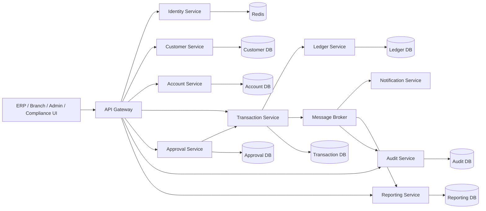

# High-Level Design (HLD)

## 1. Overview
This banking platform is designed for secure, auditable, and highly operable financial workflows. The system supports customer onboarding, account lifecycle, internal transfers, approvals, ledger posting, notifications, and reporting while enforcing enterprise banking controls such as RBAC, MFA, maker-checker, double-entry accounting, and immutable audit trails.

The current repository direction favors a distributed microservices architecture with domain-aligned service boundaries, asynchronous messaging, and independent data ownership. This aligns with the ADRs in this repository: service separation, PostgreSQL and Redis foundations, JWT and MFA security, and outbox-based event publication.

## 2. Business goals
- Process financial operations accurately and reliably
- Protect customer and account data with strong authentication and authorization
- Support operational workflows for tellers, branch managers, compliance staff, and admins
- Maintain full auditability for every material change
- Scale horizontally as transaction and user volume increase
- Allow independent delivery and deployment of domain capabilities

## 3. Non-functional requirements
- Availability: operationally resilient with degraded-mode handling where possible
- Consistency: strong transactional guarantees within each service boundary
- Auditability: append-only historical record of state-changing actions
- Security: TLS in transit, role-based access, MFA for privileged actions, rate limiting
- Performance: low-latency reads for account and customer lookups; resilient async processing for approvals and notifications
- Observability: request correlation IDs, logs, metrics, and tracing across service boundaries

## 4. Scope
### In scope
- Customer onboarding and KYC metadata
- Account opening, status changes, and balance view
- Internal transfers and payment requests
- Administrative account freeze/unfreeze actions
- Maker-checker approval process for risk-sensitive operations
- Ledger posting and financial reconciliation
- Notifications and dashboard/reporting
- Audit log exploration and incident investigation

### Out of scope for initial release
- Real-time cash settlement with external banking networks
- Card issuing and ACH external payment rails
- Consumer mobile app
- Full open-banking integrations
- Advanced analytics platform beyond reporting basics

## 5. Architecture principles
1. Domain ownership: each service owns its own business logic and database
2. Explicit contracts: APIs and events are designed as contracts rather than implicit DB access
3. Double-entry integrity: no balance mutation without a valid ledger posting
4. Security by default: auth and authorization are enforced at API and service boundaries
5. Resilience-first integration: retries, idempotency, circuit breakers, and outbox pattern
6. Traceability: every operation includes correlation metadata and audit events

## 6. High-level system context

## 7. Service boundaries
| Service | Responsibility |
|---|---|
| API Gateway | Auth enforcement, request routing, rate limiting, observability metadata |
| Identity | JWT issuance, refresh, MFA, RBAC, session lifecycle |
| Customer | KYC, customer profiles, branch assignment, customer lookups |
| Account | Account opening, balances, account status history, customer-account mapping |
| Transaction | Payment/transfer request creation and validation |
| Ledger | Double-entry journal posting and balance reconciliation |
| Approval | Maker-checker tasks, policy checks, decisions and reason capture |
| Audit | Append-only audit storage and event replay support |
| Notification | Email/SMS/in-app alerts driven by domain events |
| Reporting | Aggregated metrics, exports, and operational reports |

## 8. Core business flows
### Customer onboarding
1. Customer record is created in Customer service
2. Branch and compliance metadata are assigned
3. KYC evidence and validations are stored
4. Audit event is emitted for lifecycle tracking

### Account opening
1. Customer identity is validated
2. Account is created with the configured product parameters
3. Account status is initialized and recorded
4. Balance is seeded as applicable for account type

### Transfer / payment execution
1. Transaction service validates account status, amount rules, and idempotency
2. A pending transfer request is stored
3. If the operation requires approval, approval task is created
4. On approval, ledger service posts debit and credit entries
5. Balance updates and downstream events are emitted

### Approval workflow
1. A critical action is submitted as a maker request
2. Compliance or branch approvers receive a task in approval inbox
3. Approver reviews risk metadata and transaction context
4. Approval or rejection is persisted and audit-logged

## 9. Security and compliance architecture
- Authentication: JWT access/refresh tokens issued by Identity service
- Authorization: RBAC and branch-scoped permission checks applied at gateway and service layers
- Privileged actions: MFA challenge required for sensitive operations or role assignment
- Failed login tracking: authentication failures are persisted and evaluated for lockout thresholds
- Audit trail: all write operations and decisions recorded immutably
- Data protection: TLS for all service-to-service and client connections; encryption for sensitive data at rest
- Controls: rate limiting, authentication lockout, failed login monitoring, and risk checks on large transfers

## 10. Data architecture
Each service owns a dedicated schema and database. Cross-service consistency is achieved through explicit domain events and integration contracts, not direct DB access. The outbox pattern ensures event publication is durable and replayable.

Core data domains include:
- identity: users, sessions, roles, permissions, MFA challenges
- customer: customers, branches, KYC, permissions
- account: accounts, products, status history
- transaction: payment requests, transaction references, idempotency keys
- ledger: postings, balances, journal batches
- approval: tasks, policy decisions, approval reasons
- audit: immutable event stream and investigation history
- reporting: job metadata and aggregated results

## 11. Deployment and operational model
- Application runtime: Spring Boot services packaged as deployable artifacts or containers
- Container orchestration: Kubernetes or equivalent runtime for independent scaling
- Messaging: Kafka or RabbitMQ for reliable async event delivery
- Caching: Redis for session data, rate limiting, and hot reads
- Observability: distributed tracing, structured logging, metrics, and correlation IDs
- CI/CD: automated build, test, and container publication across backend services

## 12. Risks and trade-offs
- Higher operational complexity than a monolith
- Eventual consistency across domains requires careful orchestration and idempotent APIs
- Data modeling and API versioning must remain disciplined to avoid contract drift
- Approval workflows add latency for high-risk actions but materially reduce risk exposure

## 13. Alignment with repository ADRs
This HLD is consistent with the existing ADRs for:
- modular service decomposition
- PostgreSQL and Redis platform choices
- JWT/MFA/RBAC security posture
- double-entry ledger model
- maker-checker workflow
- outbox-based event delivery
