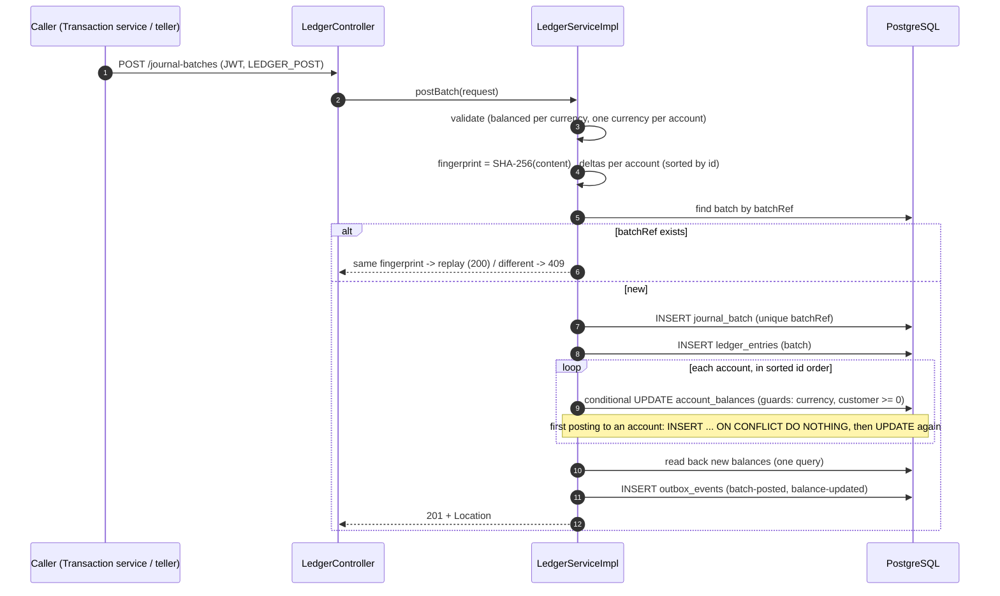

# Ledger service - purpose and how it works

## 1. Purpose

The Ledger is the bank's **book of record for money**. Every movement of funds - a deposit, a withdrawal, a transfer,
a fee - is recorded as a **balanced set of entries** (double-entry bookkeeping), and the current balance of every account is
derived from, and kept consistent with, that journal.

| Question | Answered by |
|---|---|
| What is this account's balance right now? | `GET /accounts/{id}/balance` |
| Which postings explain that balance? | `GET /accounts/{id}/entries` (statement) |
| What exactly happened in one operation? | `GET /journal-batches/{id}` |
| Can I trust the stored balance? | `GET /accounts/{id}/reconciliation` |

It does **not** own account records (Account service), customer data (Customer), or authorization of who may move money
(Transaction/Approval, still to be built). It only guarantees that whatever is posted is balanced, durable, immutable and
never overdraws a customer account.

Port `9004`, routed by the Gateway under `/api/v1/ledger/**`, database `bank_ledger`.

## 2. Core concepts

| Concept | Meaning |
|---|---|
| **Journal batch** | One atomic, balanced posting. Identified by a caller-supplied `batchRef` (idempotency key). |
| **Entry** | One line of a batch: account, `DEBIT` or `CREDIT`, positive amount (max 2 decimals), currency, optional reference. |
| **Balance** | Per-account running balance (`ledgerBalance`, `availableBalance`) with a monotonic `balanceVersion`. |
| **Account kind** | `CUSTOMER` (never negative) or `SYSTEM` (bank-owned GL accounts such as cash; may go negative). System accounts are listed in `bank.ledger.system-accounts`. |

**Sign convention:** a `CREDIT` adds to an account's balance, a `DEBIT` subtracts. Because every batch is balanced
(sum of debits = sum of credits, per currency), the balances of all accounts in a currency always sum to zero.

Example - a customer deposits 100.00 in cash:

| Line | Account | Type | Amount | Effect |
|---|---|---|---|---|
| 1 | Bank cash (system) | DEBIT | 100.00 | cash balance -100.00 (the bank holds the cash) |
| 2 | Customer | CREDIT | 100.00 | customer balance +100.00 |

## 3. API

All calls require a JWT issued by Identity (validated by CommonSecurity) and a permission.

| Method | Path | Permission | Result |
|---|---|---|---|
| POST | `/api/v1/ledger/journal-batches` | `LEDGER_POST` | `201` created, `200` idempotent replay |
| GET | `/api/v1/ledger/journal-batches/{id}` | `LEDGER_VIEW` | batch with its entries |
| GET | `/api/v1/ledger/accounts/{id}/entries` | `LEDGER_VIEW` | page of entries; filters `entryType`, `from`, `to`; sort `postedAt` or `amount` (default newest first) |
| GET | `/api/v1/ledger/accounts/{id}/balance` | `LEDGER_VIEW` | current balance |
| GET | `/api/v1/ledger/accounts/{id}/reconciliation` | `LEDGER_RECONCILE` | stored vs recomputed balance |

Role mapping (Identity migration `V6__ledger_permissions.sql`): ADMIN and MANAGER - all three; TELLER - view only;
AUDITOR - view and reconcile.

Request body for posting:

```json
{
  "batchRef": "TXN-2026-000123",
  "sourceService": "transaction-service",
  "sourceEvent": "cash.deposit",
  "entries": [
    { "accountId": "00000000-0000-7000-8000-000000000001", "entryType": "DEBIT",  "amount": 100.00, "currency": "EGP" },
    { "accountId": "<customer-account-uuid>",              "entryType": "CREDIT", "amount": 100.00, "currency": "EGP", "reference": "Cash deposit" }
  ]
}
```

Errors use the shared contract (`code`, `message`, correlation id):

| Status | Code | When |
|---|---|---|
| 401 | `UNAUTHENTICATED` | missing/invalid/expired token |
| 403 | `ACCESS_DENIED` | caller lacks the permission |
| 404 | `RESOURCE_NOT_FOUND` | unknown batch or account (no balance row yet) |
| 400 | `BAD_REQUEST` | unsupported sort, `from` after `to` |
| 409 | `DUPLICATE_RESOURCE` | `batchRef` reused with different content |
| 422 | `VALIDATION_FAILED` | field violations (fewer than 2 entries, non-positive/3-decimal amount, bad currency, ...) |
| 422 | `BUSINESS_RULE_VIOLATION` | unbalanced batch, mixed currencies on one account, insufficient funds |

## 4. How posting works



Everything from step "INSERT journal_batch" onward is **one transaction**: any failure (e.g. insufficient funds) rolls back
the batch, entries, balances and outbox rows together.

### Guarantees and how they are enforced

| Guarantee | Mechanism |
|---|---|
| Double entry | `JournalBatchValidator`: debits = credits per currency, at least 2 entries, one currency per account |
| Idempotency | unique `batch_ref` + SHA-256 `request_hash` (content-based, order-independent) |
| No lost updates | balance change is a single atomic `UPDATE ... SET balance = balance + :delta`, never read-modify-write |
| No overdraft | the same `UPDATE` carries `WHERE balance + :delta >= 0` for customer accounts; a table `CHECK` is the last line of defence |
| No deadlocks | accounts are always updated in ascending id order, so opposing transfers acquire row locks in the same order |
| Concurrent duplicate `batchRef` | the batch row is inserted first, so the unique index rejects the loser before any balance is touched (409) |
| Immutable history | database triggers reject `UPDATE`/`DELETE`/`TRUNCATE` on `ledger_entries` and `journal_batches`; corrections are new, opposite batches |
| Currency integrity | an account keeps the currency of its first posting; a different currency is rejected |
| Auditability | each post logs `AUDIT ledger-batch-posted` with actor and correlation id; the batch stores `posted_by` |

## 5. Balance sync to the Account service

Account keeps a read-only snapshot of the balance. The Ledger does not call Account synchronously; it writes
**transactional outbox** rows in the same transaction as the posting:

| Event | Payload | Emitted for |
|---|---|---|
| `ledger.batch-posted` | batch summary | every batch |
| `ledger.balance-updated` | `ApplyBalanceSnapshotRequest(accountId, ledgerBalance, availableBalance, balanceVersion)` | CUSTOMER accounts only |

`balanceVersion` lets Account ignore stale or duplicated snapshots. **Not built yet:** the relay that publishes outbox rows
and the Account-side consumer (tracked as A1/X1/X2 in `service-gaps.md`).

## 6. Reconciliation

`GET /accounts/{id}/reconciliation` compares the stored balance with `SUM(CREDIT) - SUM(DEBIT)` recomputed from the journal
using the covering index (no table access). `consistent=false` (and an `AUDIT ledger-reconciliation-mismatch` error log)
means the stored balance was altered outside the application - the journal is the truth.

## 7. Performance design

- **Fixed statement count** per posting to existing accounts (idempotency lookup, batch insert, entries insert, one UPDATE per
  account, one balance read-back, outbox rows); asserted in `LedgerApiIntegrationTest`.
- **No JPA associations**, immutable (`@Immutable`) entities, UUIDv7 ids assigned in `@PrePersist` (index-friendly, no round trip).
- **Index `(account_id, posted_at desc, id desc) include (entry_type, amount)`** serves the default statement ordering
  without a sort step, and reconciliation as an index-only scan.
- **`account_balances` fillfactor 70** keeps the hot updates HOT (no index maintenance; the only index is on the immutable `account_id`).
- **Sort whitelist** (`postedAt`, `amount`) with a unique `id` tie-breaker, so paging is stable and client input never reaches the query.

## 8. Code layout (`Backend/Ledger`, package `org.bank.ledger`)

| Package | Responsibility |
|---|---|
| `controller` | REST endpoints, permission checks, `SafePageable` |
| `service`, `service/implementation` | `LedgerService`; `JournalBatchValidator`, `BalanceDeltas`, `BatchFingerprint`, `BalanceUpdater`, `OutboxRecorder` (one job each) |
| `repository` | Spring Data repositories, native balance update, reconciliation query, specifications for statements |
| `model` | `JournalBatch`, `LedgerEntry`, `AccountBalance`, `OutboxEvent` |
| `mapper` | MapStruct (+ Lombok) mapping entities to DTOs |
| `event` | outbox event names and payloads |
| `config`, `aop` | properties (`bank.ledger.system-accounts`), OpenAPI, global exception handler |

DTOs, requests, responses and enums live in `CommonsDTO` (`org.bank.common.dto`). Configuration is served by the Config
Server from `Banking-System-Application-config/ledger`; the schema is in `infra/db/migration/ledger` (mirrored in
`src/main/resources/db/migration`).

## 9. Configuration

| Property / variable | Meaning |
|---|---|
| `SERVER_PORT` | default `9004` |
| `POSTGRES_HOST/PORT/DB/USER/PASSWORD` | database (default `localhost:5434/bank_ledger`) |
| `bank.ledger.system-accounts` / `LEDGER_SYSTEM_ACCOUNTS` | comma-separated UUIDs of bank-owned accounts allowed to go negative. Dev defaults: `00000000-0000-7000-8000-000000000001` (cash) and `...0002`. **Required in prod** (no default). |
| `IDENTITY_JWT_ISSUER`, `IDENTITY_JWK_SET_URI` | token validation |

## 10. Trying it

1. Start Config, Discovery, Identity, Gateway and Ledger (plus Postgres).
2. Import `docs/postman/ledger.postman_collection.json` and `local.postman_environment.json`.
3. Log in through the Identity collection as `manager1` (or `admin` with MFA), then run the Ledger collection top to bottom:
   deposit, withdraw, queries, reconciliation, idempotency, and the expected-error requests.
4. Automated checks: `./mvnw verify` in `Backend/Ledger` (Docker required for the Testcontainers integration tests).

## 11. Known limits / next steps

- Outbox relay and Account consumer; scheduled reconciliation; branch scoping of ledger accounts; reversal batches;
  the Transaction service as the real caller of `POST /journal-batches`.
