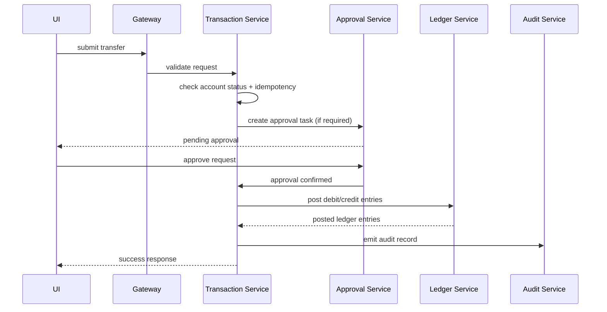

# Low-Level Design (LLD)

## 1. Design purpose
This document provides the implementation-level blueprint for the banking platform. It specifies service responsibilities, data structures, APIs, event contracts, resilience patterns, and validation rules aligned with the repository's ADRs.

## 2. Application architecture per service
### 2.1 API Gateway
Responsibilities:
- Securely terminate and route external requests
- Enforce API versioning such as `/api/v1/...`
- Validate JWTs and propagate auth claims downstream
- Apply rate limits, correlation IDs, and request tracing
- Route requests to the correct service domain

Key components:
- Route definitions
- Authentication filter
- Authorization filter
- Request-id/correlation middleware
- Error translation layer

### 2.2 Identity Service
Responsibilities:
- User lifecycle management
- Role and permission model
- JWT issuer and refresh token handling
- MFA challenge and verification
- Login throttling and session tracking
- Persistent login-attempt audit and account lockout

Core entities:
- User
- Role
- Permission
- Session
- LoginAttempt
- MfaChallenge

Key APIs:
- `POST /api/v1/auth/login`
- `POST /api/v1/auth/refresh`
- `POST /api/v1/auth/mfa/verify`
- `POST /api/v1/users`
- `POST /api/v1/roles`

Validation rules:
- Simultaneous login attempts are bounded by lockout policy
- Failed authentication attempts are recorded in `login_attempts` with request metadata
- Accounts are locked after repeated invalid password attempts within a configured window
- MFA is mandatory for privileged or high-risk operations
- Role assignment is constrained by branch and permission domain

### Login attempt model
- `login_attempts`: id, user_id, username, ip_address, user_agent, result, failure_reason, correlation_id, created_at
- Failed attempts increment `users.failed_login_count` and update `users.last_failed_login_at`
- Successful login resets `failed_login_count` to zero and clears `locked_until`
- Lockout is enforced by checking `users.locked_until` before processing a new login request

### 2.3 Customer Service
Responsibilities:
- Customer profile management
- Branch assignment and KYC tracking
- Customer status metadata and account correlation

Core entities:
- Customer
- Branch
- KycRecord
- CustomerStatusHistory

Key APIs:
- `POST /api/v1/customers`
- `GET /api/v1/customers/{id}`
- `GET /api/v1/customers/{id}/accounts`
- `PATCH /api/v1/customers/{id}/status`

Rules:
- Customer identities must be unique and strongly validated
- Account linkage requires a valid customer and branch context
- KYC records are immutable once approved or rejected

### 2.4 Account Service
Responsibilities:
- Account product definition and lifecycle
- Account creation and state transitions
- Balance retrieval and account state history

Core entities:
- Account
- AccountProduct
- AccountStatusHistory

Key APIs:
- `POST /api/v1/accounts`
- `GET /api/v1/accounts/{id}`
- `GET /api/v1/accounts/{id}/balance`
- `POST /api/v1/accounts/{id}/freeze`
- `POST /api/v1/accounts/{id}/unfreeze`

Rules:
- Account numbers are unique
- Balance mutation is only allowed through valid ledger posting events
- Account freeze/unfreeze triggers approval if policy requires it

### 2.5 Transaction Service
Responsibilities:
- Validate transfer or debit/credit operations
- Store payment requests with idempotency keys
- Determine whether an operation requires approval
- Publish events for downstream processing

Core entities:
- Transaction
- PaymentRequest
- IdempotencyKey

Key APIs:
- `POST /api/v1/transactions/internal-transfer`
- `POST /api/v1/transactions/payment-request`
- `GET /api/v1/transactions/{id}`
- `POST /api/v1/transactions/{id}/retry`

Rules:
- Every transfer must include an idempotency key and correlation metadata
- Accounts must be in valid states before posting
- Currency must be consistent across debit and credit legs
- Daily limits and AML checks are enforced before request acceptance

### 2.6 Ledger Service
Responsibilities:
- Record double-entry journal entries
- Reconcile balances and maintain posting integrity

Core entities:
- LedgerEntry
- JournalBatch
- BalanceSnapshot

Key APIs:
- `POST /api/v1/ledger/journal-batches`
- `GET /api/v1/ledger/accounts/{id}/entries`
- `GET /api/v1/ledger/accounts/{id}/balance`

Rules:
- Every credit must have a matching debit entry in the same batch
- No balance update without a ledger entry audit record
- Reconciliation is performed on each posting event and scheduled periodic checks

### 2.7 Approval Service
Responsibilities:
- Manage approval policies and tasks
- Expose maker-checker workflows
- Record decision reasons and approver metadata

Core entities:
- ApprovalTask
- ApprovalPolicy
- ApprovalDecision

Key APIs:
- `POST /api/v1/approvals/tasks`
- `GET /api/v1/approvals/tasks/inbox`
- `POST /api/v1/approvals/tasks/{id}/approve`
- `POST /api/v1/approvals/tasks/{id}/reject`

Rules:
- High-risk operations require dual control and explicit reason metadata
- Approvals are immutable once recorded
- Decision status must be logged to Audit service

### 2.8 Audit Service
Responsibilities:
- Capture append-only immutable audit records for writes and approvals
- Support investigations and forensic review

Core entities:
- AuditLog
- EventStoreEntry

Key APIs:
- `POST /api/v1/audit/logs`
- `GET /api/v1/audit/search`
- `GET /api/v1/audit/entities/{type}/{id}`

Rules:
- Logs are append-only and cannot be deleted by application code
- All payloads include actor, target, action, time, and correlation metadata

### 2.9 Notification Service
Responsibilities:
- Deliver alerts triggered by bank events
- Manage notification templates and channel-specific delivery

Core entities:
- Notification
- NotificationChannel
- NotificationTemplate

Key APIs:
- `POST /api/v1/notifications`
- `GET /api/v1/notifications/{id}`

Rules:
- Notifications are asynchronous and idempotent by business key when possible
- Delivery failures are retried with backoff and dead-letter handling

### 2.10 Reporting Service
Responsibilities:
- Aggregate operational and financial metrics
- Produce export jobs for reports and audits

Core entities:
- ReportJob
- AggregatedMetric

Key APIs:
- `POST /api/v1/reports/jobs`
- `GET /api/v1/reports/jobs/{id}`
- `GET /api/v1/reports/exports/{id}`

Rules:
- Export generation is asynchronous for large datasets
- Reporting reads should avoid coupling directly to operational write databases

## 3. Shared integration patterns
### 3.1 Messaging and events
Each producer service persists domain events in an outbox table within the same transaction as the business change. An outbox relay publishes these events to Kafka or RabbitMQ after commit.

Example event types:
- `CustomerCreated`
- `AccountOpened`
- `TransferRequested`
- `TransferApproved`
- `LedgerPosted`
- `ApprovalRejected`
- `AuditLogged`

### 3.2 Idempotency
Financial APIs must support idempotency keys to prevent duplicate processing during retries. The transaction service stores a dedupe key and returns the original result for repeats.

### 3.3 Resilience
- Retries with exponential backoff for transient network failures
- Circuit breakers for downstream dependencies
- Request timeouts and safe fallback behaviors
- Dead-letter queues or retry topics for event processing

## 4. Data model summaries
### Identity
- users: id, username, email, password_hash, status, created_at
- roles: id, name, description
- permissions: id, code, scope
- user_roles: user_id, role_id
- sessions: id, user_id, refresh_token_hash, expires_at
- mfa_challenges: id, user_id, challenge_id, status, issued_at
- login_attempts: id, user_id, username, ip_address, user_agent, result, failure_reason, correlation_id, created_at

### Customer
- customers: id, customer_no, first_name, last_name, kyc_status, branch_id
- branches: id, code, name
- kyc_records: id, customer_id, type, evidence_ref, status, reviewed_by

### Account
- accounts: id, account_no, customer_id, product_id, status, currency, balance
- account_products: id, code, name, min_balance, allowed_features
- account_status_history: id, account_id, previous_status, new_status, changed_by, changed_at

### Transaction
- payment_requests: id, request_ref, from_account_id, to_account_id, amount, currency, status, idempotency_key
- idempotency_keys: id, key, request_hash, response_digest, created_at

### Ledger
- ledger_entries: id, batch_id, account_id, entry_type, amount, currency, reference, created_at
- journal_batches: id, batch_ref, status, created_at
- balances: account_id, current_balance, updated_at

### Approval
- approval_tasks: id, task_ref, entity_type, entity_id, action, status, created_by, created_at
- approval_decisions: id, task_id, approver_id, decision, reason, decided_at

### Audit
- audit_logs: id, actor_id, actor_type, entity_type, entity_id, action, payload, created_at
- event_store: id, aggregate_id, event_type, payload, created_at

## 5. Sequence flows
### 5.1 Internal transfer approval flow

### 5.2 Balance update flow
- Transfer is approved by approval policy
- Transaction service calls ledger service with debit/credit payload
- Ledger service updates balance snapshots and emits a posting event
- Account service or consumer listens for the event and updates cached or derived account metadata

## 6. Security implementation details
- Gateway validates tokens and attaches user identity claims
- Service-level security checks use claims for role, branch, and functional permission
- Sensitive fields are masked in responses when user role lacks permission
- High-risk endpoints require 2FA and approval context
- All service-to-service requests enforce TLS, request signing or mTLS depending on environment, and correlation IDs

## 7. Testing strategy
### Unit tests
- Domain validation rules for transfers, account lifecycle, and ledger integrity
- Security checks for authorization success and denial paths

### Integration tests
- Database-backed scenarios using Testcontainers
- End-to-end flows for transfer, approval, and ledger posting

### Contract tests
- Validate request/response models for API versions and downstream integrations

### Security tests
- RBAC bypass tests
- MFA checks for privileged operations
- Rate-limit and lockout behavior tests

## 8. Operational considerations
- Deployment should separate stateless services from stateful data stores
- Configure health checks, readiness endpoints, and graceful degradation on dependency failures
- Propagate correlation IDs through logs, traces, and asynchronous event messages
- Ensure alerting for approval queue backlog, ledger reconciliation mismatches, and auth anomalies

## 9. Implementation readiness checklist
- Service skeletons for gateway, identity, customer, account, transaction, ledger, approval, audit, notification, and reporting
- Shared config for JWT validation, observability, and security policies
- Database migration scripts per bounded context
- Outbox relay and broker integration configuration
- Test suite for transfer and approval flows
- Dashboard and audit exploration endpoints for operational use
