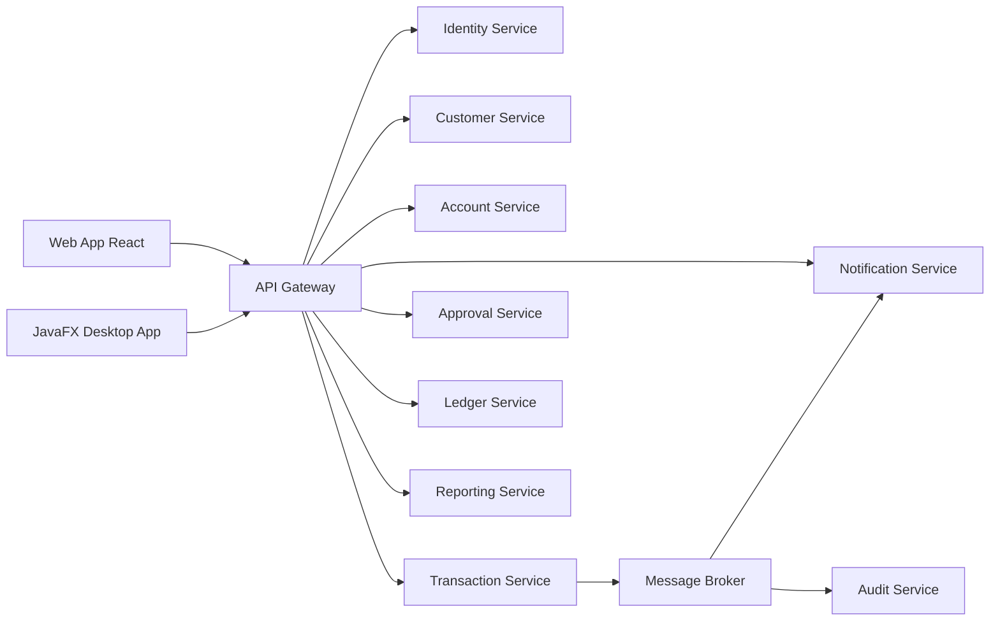
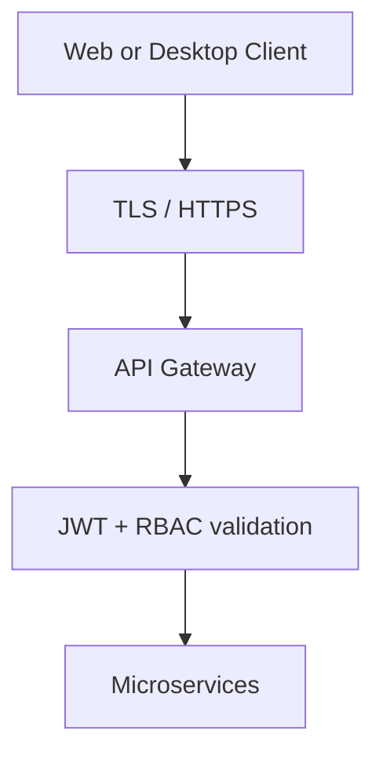
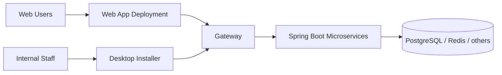

# Frontend Architecture

## 1. Overview

This frontend architecture supports a banking platform that already follows a microservices-first backend model. The frontend is intentionally split into two client types:

- a browser-based web application
- a Java desktop application

Both are clients of the backend system and should not be embedded into the microservices architecture.

## 2. Architectural decision

### Decision
The desktop application is a client UI, not a microservice. Both the web app and the Java desktop app should call the backend through the API Gateway and REST APIs.

### Why
- backend owns all business logic and domain rules
- frontend stays simple and focused on user experience
- microservices remain independently deployable
- security is centralized and easier to enforce
- same API contract can support both frontends

## 3. High-level architecture



## 4. Frontend responsibilities by layer

### Web App responsibilities
- browser access for admins, branch staff, and operations users
- dashboards and reporting views
- customer/account management screens
- approval workflows
- modern responsive UI for complex business operations

### Desktop App responsibilities
- internal staff workstation workflows
- customer and account lookup
- approval queue
- transaction review and quick action execution
- branch operations
- secure local workflow support

## 5. Proposed frontend split

| Frontend | Role | Best users | Recommended technology |
|---|---|---|---|
| Web App | browser-based business dashboard | admins, managers, support staff | React + TypeScript |
| Desktop App | operational internal client | tellers, branch staff, approvers | Java 21 + JavaFX |

## 6. Web app module breakdown

```text
web-app/
  src/
    app/
      routes/
      layouts/
      providers/
    features/
      auth/
      customers/
      accounts/
      transfers/
      approvals/
      ledger/
      reporting/
      notifications/
    shared/
      api/
      components/
      hooks/
      utils/
      types/
      guards/
      constants/
    styles/
```

### Web app feature areas
- auth and session management
- customer onboarding and profile management
- account lifecycle management
- transfer creation and review
- approval inbox and decision actions
- ledger and audit viewing
- notifications and reporting

## 7. Desktop app module breakdown

```text
desktop-app/
  src/
    main/
      java/
        com.banking.desktop/
          app/
          config/
          ui/
            controllers/
            views/
            components/
          services/
            api/
            auth/
            session/
          models/
          utils/
          security/
      resources/
        fxml/
        css/
```

### Desktop app feature areas
- login and MFA flow
- customer lookup and profile
- account overview panel
- transaction search and review
- approval task queue
- local secure cache for recent records
- branch/operational dashboard

## 8. Shared backend integration model

Both frontends will integrate with the same backend contracts:

- identity service for login and user permissions
- customer service for customer management
- account service for account lifecycle
- transaction service for payment and transfer flows
- approval service for maker-checker processing
- ledger service for financial postings
- reporting service for summaries and exports
- notification service for alerts and messages

## 9. Security architecture



### Security rules
- JWT issued by identity service
- each request validated by gateway and service layer
- MFA required for privileged operations
- desktop tokens stored in secure local storage
- business rules are validated server-side
- frontend never determines final authorization on its own

## 10. Recommended technical stack

### Web app
- React
- TypeScript
- Vite
- Tailwind CSS
- TanStack Query
- React Router
- Axios or Fetch
- Recharts

### Desktop app
- Java 21
- JavaFX
- Maven or Gradle
- FXML + CSS
- ControlsFX
- OkHttp or Retrofit
- OS secure token storage

## 11. Data flow patterns

### Web app flow
1. user logs in
2. frontend calls auth API
3. JWT returned and stored securely
4. frontend requests data from API Gateway
5. backend validates permission and business logic
6. UI renders result

### Desktop app flow
1. staff logs in
2. app receives JWT
3. app loads user permissions and role-aware menus
4. app calls backend APIs for customer/account/approval tasks
5. user executes operations with backend-enforced validation

## 12. Deployment model



## 13. Suggested implementation sequence

### Phase 1: API foundation
- define OpenAPI contracts
- auth and MFA flows
- gateway routing and permissions
- error response standardization

### Phase 2: Web app MVP
- login and dashboard
- customer and account pages
- transfer and approval screens

### Phase 3: Desktop app MVP
- login and session handling
- customer lookup and account status
- approval queue and decision processing

### Phase 4: Reporting and notification layer
- charts and summaries
- notifications and activity feed
- exporter pages and audit views

### Phase 5: Hardening and production readiness
- security review
- performance tuning
- installer packaging
- end-to-end testing

## 14. Recommended final architecture direction

The final architecture for this project should be:

- Web app for browser users and dashboards
- Java desktop app for internal operational workflows
- both frontends calling the same microservice APIs through the gateway
- frontend remains a thin client; backend remains the source of truth

This is the cleanest and most realistic architecture for a banking platform of this kind.

## 15. Final conclusion

The frontend should not be treated as part of the microservices. It should be a decoupled client layer that communicates over REST. This gives the project better security, better domain separation, easier maintenance, and clearer long-term scalability.
