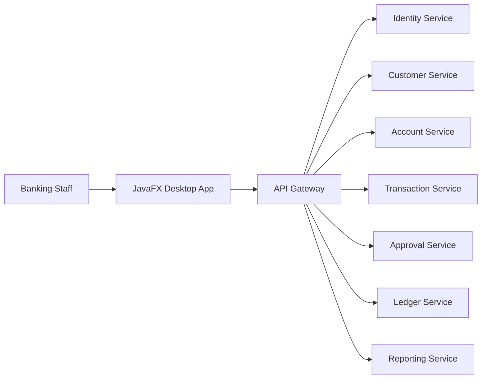

# Java Desktop Application Roadmap

## 1. Goal

Build a Java desktop client for internal banking users who need quick, secure access to operational workflows such as customer lookup, approvals, account review, and branch operations. This desktop app should be a frontend client that uses the same upstream microservices via REST.

## 2. Recommended stack

- Java 21
- JavaFX
- Maven or Gradle
- FXML + CSS
- ControlsFX
- OkHttp or Retrofit
- JJWT or equivalent JWT handling
- OS keychain / encrypted local storage for session tokens
- Lombok (optional for cleaner Java model code)

## 3. Why JavaFX is the best choice

### JavaFX advantages
- modern desktop UI toolkit
- better look and feel than Swing
- good support for forms, tables, tabs, dialogs, charts
- ideal for internal enterprise tooling

### Why not Swing
- older UI model
- harder to build professional enterprise experience
- less attractive for a banking operations app

## 4. Role in the architecture

The desktop app is not a microservice. It is a client application that connects to the backend services through the API Gateway.



## 5. Core responsibilities of the desktop app

- login and MFA handling
- customer search and detail view
- account overview and status checks
- approval queue review
- transaction review and operation submission
- branch-level work summaries
- internal user dashboard
- recent local cache of customer/account data for fast access

## 6. Recommended project structure

```text
java-desktop-app/
  src/
    main/
      java/
        com.banking.desktop/
          app/
          config/
          ui/
            controllers/
            views/
            components/
          services/
            api/
            auth/
            session/
          models/
          utils/
          security/
      resources/
        fxml/
        css/
        images/
  pom.xml
```

## 7. Suggested screens

### Authentication
- login screen
- MFA verification dialog
- session timeout warning
- logout confirmation

### Customer screens
- customer search
- customer detail panel
- customer profile editor
- activity timeline

### Account screens
- account list and filters
- account detail page
- open account workflow
- freeze/unfreeze controls

### Transaction screens
- transfer submission form
- transaction lookup
- transaction detail view
- status tracking panel

### Approval screens
- approval inbox
- task detail page
- approve/reject actions
- reason notes and audit comments

### Reporting screens
- daily operations summary
- pending approvals overview
- account status report
- transaction trend summary

## 8. Recommended UI design patterns

- tabbed layout for operational workspaces
- side navigation for main modules
- searchable tables with filters
- clear distinction between read-only and editable views
- explicit confirmation dialogs for financial actions
- status badges for account and approval states
- role-aware menus and permissions

## 9. API integration strategy

### REST usage pattern
- use a centralized API service layer
- each screen uses typed request/response models
- use token interceptor for JWT injection
- centralize retry and error handling
- handle 401/403 responses properly with re-login flow

### Local data cache
Use a small, secure cache for:
- recent customer searches
- recent account list
- approval queue snapshot
- last selected records

Do not store sensitive customer data permanently in plain text.

## 10. Security model

- store JWT in encrypted local storage or OS secure credential store
- do not persist passwords locally
- use HTTPS only
- enforce backend authorization on all business operations
- validate all critical actions server-side
- handle token expiry and refresh gracefully

## 11. Suggested implementation roadmap

### Phase 1: Project foundation
- initialize Maven/Gradle project
- configure JavaFX
- build base app shell
- add login screen and session handling
- add API client and JWT interceptor

### Phase 2: User and account screens
- customer search and profile panel
- account lookup and status views
- account creation and update flows

### Phase 3: Transaction and approval flows
- transfer and payment workflow
- approval queue screen
- approve/reject actions with audit notes

### Phase 4: Reporting and advanced desktop UX
- dashboards and widgets
- filters and search functions
- charts and summary cards
- action-specific detail dialogs

### Phase 5: Production hardening
- secure token handling
- packaging and distribution
- offline-safe caching patterns
- logging and crash handling
- user acceptance testing

## 12. Example desktop flow

### Login flow
1. user enters credentials
2. desktop app calls identity service
3. receives JWT
4. stores token securely
5. loads user permissions
6. routes user to authorized screens

### Approval flow
1. desktop app fetches approval tasks
2. user selects a task
3. app fetches transaction details and context
4. user approves or rejects
5. app submits decision to API
6. backend handles validation and ledger updates

## 13. Testing strategy

- unit tests for utility classes
- service tests for REST client behavior
- mock server tests for authentication and API failures
- UI tests for login form, queue actions, status dialogs
- workflow tests for transfer and approval actions

## 14. Packaging and deployment

Packaging should support internal enterprise deployment:
- installer generation for Windows
- startup scripts for Linux/macOS if needed
- versioned release workflow
- update channel or packaged artifact management

## 15. Final recommendation

The Java desktop app should be a polished internal client for operational users, but not a separate business service. It should consume the same microservice APIs as the web application. This produces a better long-term architecture because the backend remains the single source of truth for business rules, while the desktop app handles the user experience and operational convenience.
