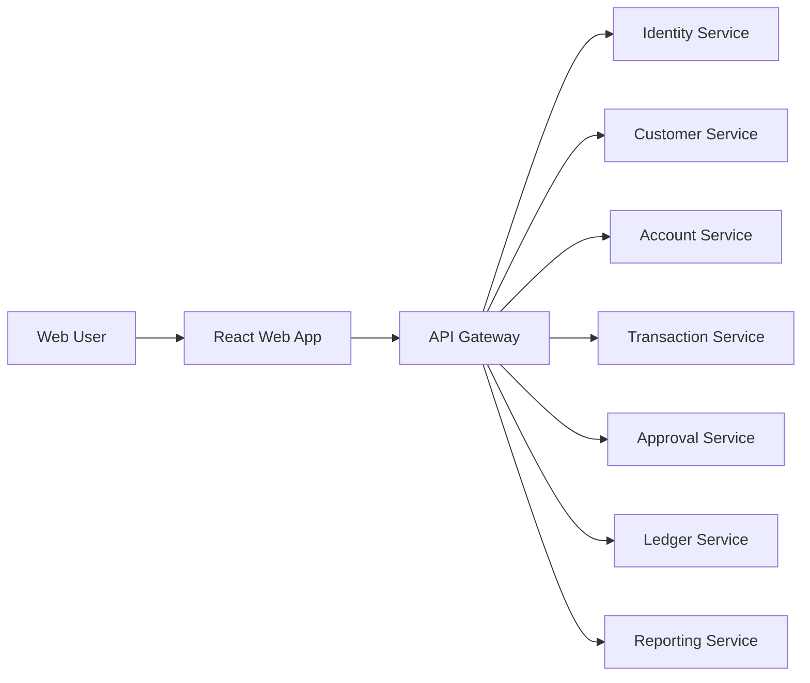

# Web Application Frontend Roadmap

## 1. Goal

Build a modern banking web application that provides a secure, responsive, and streamlined experience for admins, branch staff, operations teams, and compliance users. The web app will sit in front of the Spring Boot microservices through the API Gateway and will be the primary browser-based interface.

## 2. Recommended stack

- React
- TypeScript
- Vite
- Tailwind CSS
- React Router
- TanStack Query
- Axios or Fetch wrapper
- Zod or Yup for validation
- Recharts or ECharts for reporting
- React Hook Form for form management
- JWT-aware auth service

## 3. Why this stack

### React + TypeScript
- strong typing reduces frontend bugs
- best ecosystem for large enterprise apps
- easier to maintain as features grow

### Vite
- fast development experience
- simple build pipeline
- good for focused application teams

### Tailwind CSS
- faster UI development
- consistent styling
- good for enterprise dashboards and internal apps

### TanStack Query
- clean data fetching lifecycle
- pagination and caching support
- reduces boilerplate in API-heavy apps

## 4. System role in the overall architecture

The web app is a client layer, not part of the backend services.



## 5. Functional modules

### 5.1 Authentication and access control
- login
- MFA challenge for privileged actions
- JWT storage and refresh flow
- role-based route protection
- logout and session timeout handling

### 5.2 Customer management
- customer search
- create customer profile
- update customer details
- KYC status overview
- branch assignment and customer activity

### 5.3 Account management
- account lookup by customer or number
- open account workflow
- freeze/unfreeze account
- status history
- balance summary cards

### 5.4 Transfers and payments
- internal transfer form
- validation of amount, ledger rules, account status
- audit-friendly transaction detail page
- payment status tracking
- retry and failure handling based on API response

### 5.5 Approval engine UI
- approval inbox
- pending maker-checker tasks
- approver decision screen
- reason and notes capture
- view transaction context and risk metadata

### 5.6 Ledger and audit views
- posting summary
- ledger entries
- transaction reference list
- audit trail timeline
- action history by user and entity

### 5.7 Reporting dashboards
- branch summary
- transaction volume report
- approval throughput
- failed transaction trend
- exportable daily/monthly reporting pages

### 5.8 Notifications
- inbox and alert panel
- notification categories
- message details
- read/unread state

## 6. Suggested app structure

```text
frontend/
  src/
    app/
      routes/
      layouts/
      providers/
    features/
      auth/
      customers/
      accounts/
      transfers/
      approvals/
      ledger/
      reporting/
      notifications/
    shared/
      api/
      components/
      hooks/
      utils/
      types/
      guards/
      constants/
    styles/
      globals.css
      tailwind.css
```

## 7. UI design principles

- clean, minimal, high-contrast enterprise UX
- strong table layouts for banking data
- consistent status chips for account and transaction states
- clear approval actions with reason capture
- simple but secure multi-step forms
- accessibility focus for keyboard navigation and readability

## 8. State and API patterns

### Recommended API access pattern
- centralized API client layer
- typed request/response models
- shared auth interceptors
- consistent error handling

### State management strategy
- server-state: TanStack Query
- local UI state: React state / context
- global auth state: context provider or Zustand

## 9. Suggested pages

### Public / auth
- login
- MFA verification
- password reset or unlock flow

### Customer pages
- customer list
- customer detail
- create customer
- edit customer

### Account pages
- account list
- account detail
- account creation
- freeze/unfreeze modal

### Transaction pages
- transfer form
- transaction detail
- transaction history

### Approval pages
- approval queue
- decision detail
- approval history

### Reporting pages
- overview dashboard
- daily transaction report
- approval metrics
- export and download views

## 10. Implementation roadmap

### Phase 1: Foundation
- project setup
- design system and theme tokens
- API client layer
- auth provider and protected routes
- loading/error patterns

### Phase 2: Core domain screens
- customer pages
- account pages
- transaction and payment pages
- approval queue

### Phase 3: Reporting and analytics
- dashboard widgets
- transaction charts
- approval and risk metrics
- export-ready tables

### Phase 4: Notifications and collaboration
- inbox UI
- alerts and messages
- approval status tracking
- activity timeline

### Phase 5: Production hardening
- role-based page access
- API error monitoring
- performance optimization
- accessibility improvement
- E2E testing for key flows

## 11. Key user flows

### User login flow
1. user enters credentials
2. frontend calls identity endpoint
3. backend validates credentials and MFA if required
4. JWT returned and stored securely
5. protected pages authorize access based on role

### Approval flow
1. user opens approval inbox
2. UI fetches pending tasks
3. user reviews transaction metadata
4. submit approval or rejection
5. backend validates permission, updates ledger state, and emits events

### Transfer flow
1. user selects source and destination account
2. frontend validates basic client rules
3. API creates transfer request
4. backend validates service rules and approval requirements
5. frontend shows success or pending approval state

## 12. Testing strategy

- unit tests for form validation and utilities
- component tests for key screens
- integration tests for auth and protected flows
- end-to-end tests for login, transfer, and approval process
- API contract validation to ensure frontend matches backend DTOs

## 13. Production notes

- Keep the app thin and API-driven
- Store only minimal session state in the browser
- Validate every sensitive action server-side
- Use centralized auth and API wrappers
- Keep role-based UI gating consistent with backend permissions

## 14. Final recommendation

The web application should be the primary browser-based interface for the platform. It should be a modern React app built around the backend API layer and stay completely separate from the microservices implementation. This approach gives you clean security, maintainability, and a scalable frontend for future expansion.
